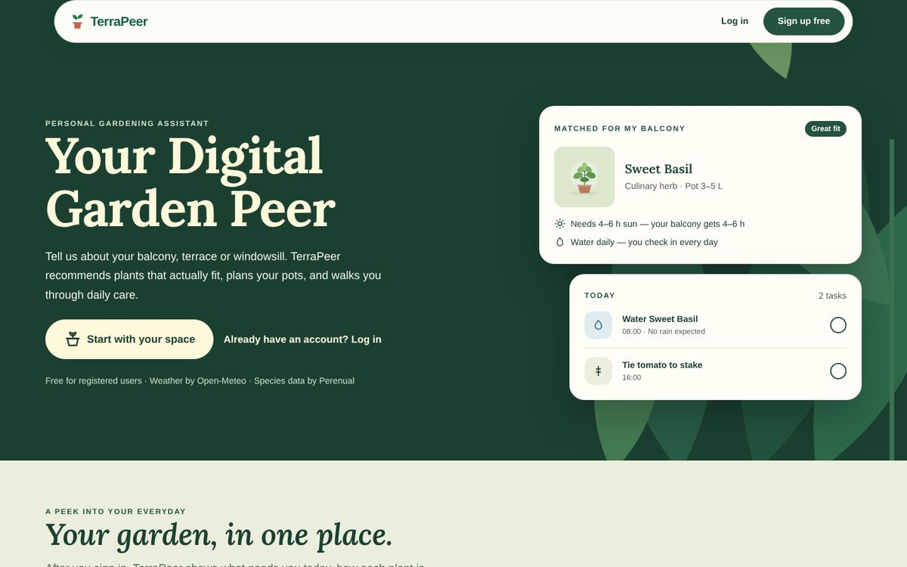
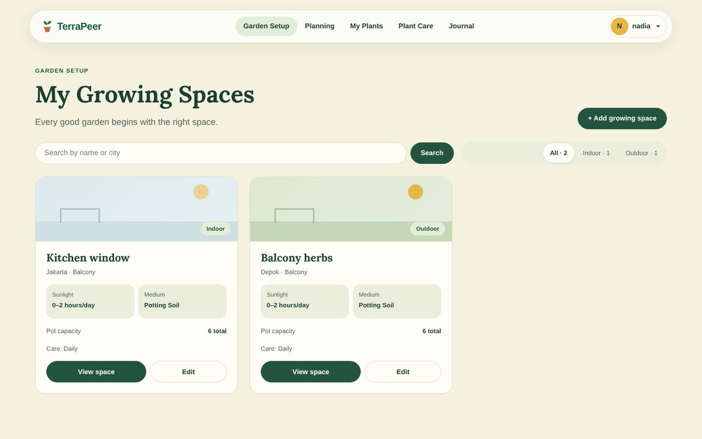
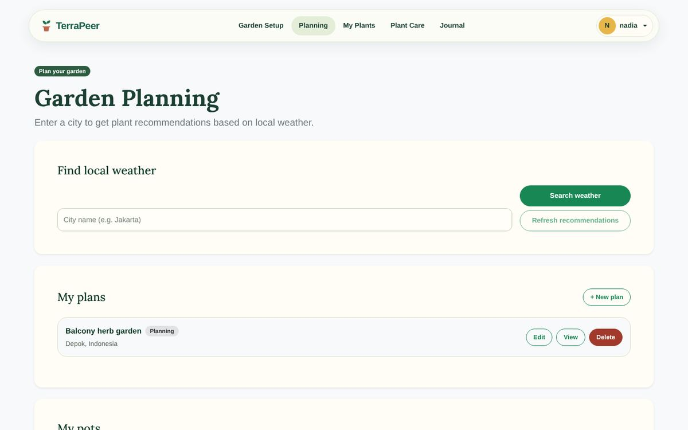
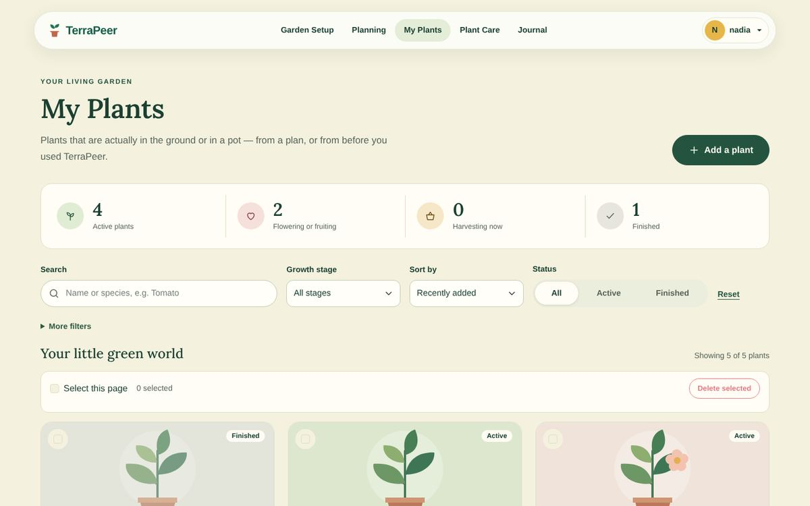
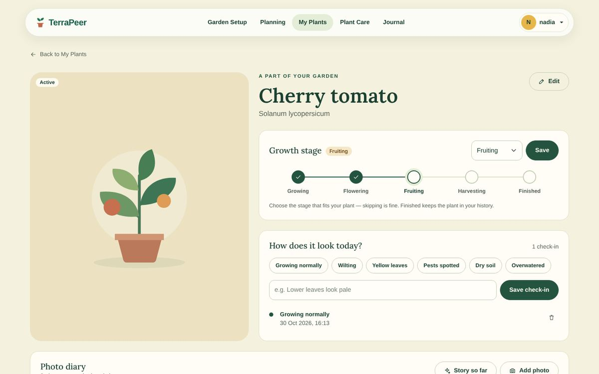
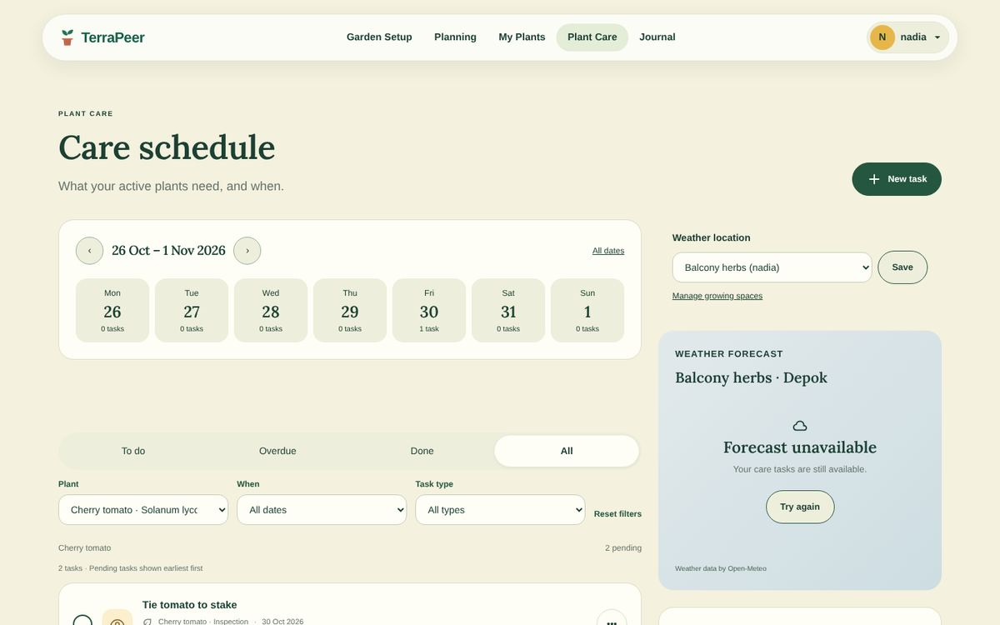
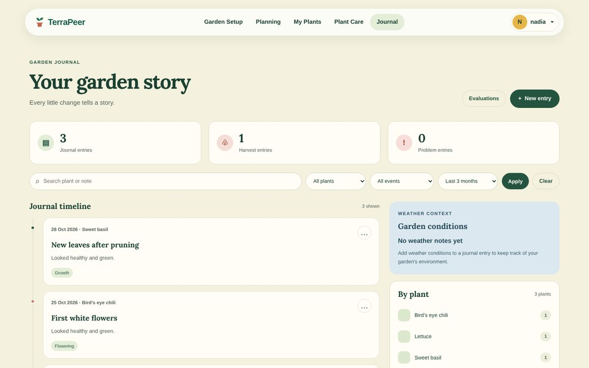
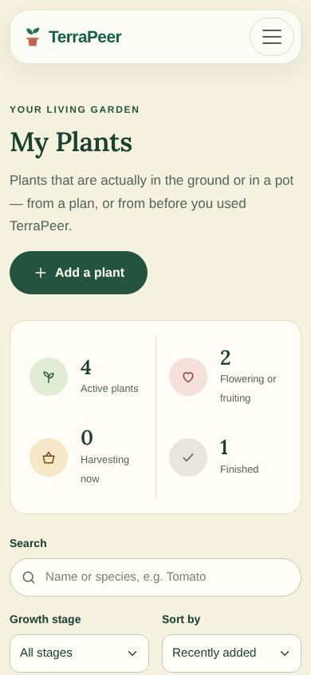
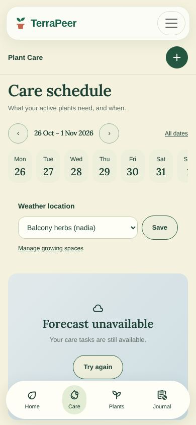

# TerraPeer

**Your Digital Garden Peer** — asisten berkebun personal: kenali ruang tanammu, pilih tanaman yang cocok, rawat setiap hari, dan simpan ceritanya.

[](https://github.com/PBP-Terrapeer-2026/TerraPeer/actions/workflows/ci.yml)
· **Aplikasi:** <https://muhammad-farel52-terrapeer.pws.cs.ui.ac.id/>
· **Desain:** [Figma TerraPeer](https://www.figma.com/design/fZa8nxPXXGqgu0ytl6WFhY/Terrapeer)



Proyek Tengah Semester PBP — Kelompok 5F.

## Daftar isi

1. [Anggota dan modul](#anggota-dan-modul)
2. [Deskripsi aplikasi](#deskripsi-aplikasi)
3. [Peran pengguna](#peran-pengguna)
4. [Modul dan fitur](#modul-dan-fitur)
5. [Integrasi antar modul](#integrasi-antar-modul)
6. [Sumber data (Public API)](#sumber-data-public-api)
7. [Desain UI/UX](#desain-uiux)
8. [Menjalankan secara lokal](#menjalankan-secara-lokal)
9. [Pengujian](#pengujian)
10. [CI/CD dan deployment](#cicd-dan-deployment)
11. [Alur kerja Git](#alur-kerja-git)
12. [Keamanan](#keamanan)
13. [AI usage disclosure](#ai-usage-disclosure)
14. [Changelog](#changelog)

## Anggota dan modul

| Modul | Anggota | GitHub | Rute utama |
| --- | --- | --- | --- |
| Garden Setup | Jotham Seanvedi Takin Allo | `seanve1` | `/garden-setup/` |
| Garden Planning | Ayyasi | `Asepgunawan112` | `/garden_planning/` |
| My Plants (+ autentikasi dan layout bersama) | Muhammad Farel Ammar | `marlioboro` | `/my-plants/` |
| Plant Care | Nashri Khalid | `nashrikhalid` | `/plant-care/` |
| Garden Journal | Adinda Pika Fauziah | `pikadinda` | `/garden-journal/` |

## Deskripsi aplikasi

TerraPeer mendampingi pengguna menanam tumbuhan sesuai kondisi lingkungannya. Pengguna mulai dengan membuat profil **ruang tanam** (lokasi, cahaya, media tanam, kemampuan merawat). Dari cuaca lokasi tersebut, TerraPeer merekomendasikan tanaman dan pot yang realistis, lalu pengguna menyusun **rencana kebun**.

Setelah benar-benar menanam, pengguna mencatat tanamannya di **My Plants**: tahap tumbuh, kondisi harian, dan foto di setiap tahap. **Plant Care** menyiapkan tugas perawatan (menyiram, memangkas, penyangga, nutrisi) dengan konteks cuaca, dan **Garden Journal** menyimpan catatan pertumbuhan, panen, serta masalah, lengkap dengan evaluasi bulanan. Saat tanaman selesai, My Plants menampilkan *growing recap* berisi seluruh perjalanan dan fotonya.

## Peran pengguna

| Peran | Akses |
| --- | --- |
| **Guest** (belum login) | Landing page, halaman register dan login. Semua halaman modul mengarahkan ke login lalu kembali ke halaman semula (`?next=`). |
| **Registered user** | Seluruh modul. Setiap data pribadi (ruang tanam, rencana, pot, tanaman, tugas, jurnal, foto) hanya bisa dilihat dan diubah oleh pemiliknya; ID milik akun lain menghasilkan 404. |

## Modul dan fitur

Setiap modul memiliki model sendiri, CRUD lengkap (HTML dan JSON), form dengan validasi server, interaksi AJAX/HTMX, filter berbasis login, dan filter data dari database.

<table>
<tr><td width="50%"></td><td width="50%"></td></tr>
<tr><td align="center">Garden Setup</td><td align="center">Garden Planning</td></tr>
<tr><td></td><td></td></tr>
<tr><td align="center">My Plants</td><td align="center">Detail tanaman, tahap tumbuh, dan photo diary</td></tr>
<tr><td></td><td></td></tr>
<tr><td align="center">Plant Care</td><td align="center">Garden Journal</td></tr>
</table>

### Garden Setup — Jotham Seanvedi Takin Allo

Profil ruang tanam: lingkungan indoor/outdoor, jenis ruang, lokasi (autocomplete Open-Meteo Geocoding, diverifikasi ulang di server), paparan cahaya, media tanam, akses hujan, penyangga, kapasitas pot, dan frekuensi perawatan.

- CRUD Growing Space, hapus lewat konfirmasi POST.
- Pencarian nama/kota dan filter indoor/outdoor.
- Form dinamis (kolom *Please specify* untuk jenis ruang `Other`) dengan live preview.

<details>
<summary>Rute Garden Setup</summary>

| Rute | Fungsi |
| --- | --- |
| `/garden-setup/` | Daftar, pencarian, dan filter Growing Space |
| `/garden-setup/create/` | Membuat Growing Space |
| `/garden-setup/<id>/` | Detail Growing Space |
| `/garden-setup/<id>/edit/` | Mengedit Growing Space |
| `/garden-setup/<id>/delete/` | Menghapus Growing Space melalui POST |
| `/garden-setup/location-search/` | Endpoint JSON pencarian lokasi |

</details>

### Garden Planning — Ayyasi

Cari kota, ambil cuaca Open-Meteo, lalu dapatkan rekomendasi tanaman Perenual dan pot yang sesuai dengan curah hujan, suhu, radiasi, dan kelembapan.

- CRUD rencana kebun (status *planning / ready / planted*), item rencana, dan pot milik pengguna.
- Halaman ringkasan rencana, modal edit, dan daftar pot berbasis HTMX.
- Input dibersihkan dari HTML/script (XSS), data Perenual dibersihkan sebelum disimpan.

### My Plants — Muhammad Farel Ammar

Tanaman yang benar-benar sudah ditanam, dari tahap *Growing → Flowering → Fruiting → Harvesting → Finished*.

- CRUD tanaman dengan respons HTML atau JSON (`Accept: application/json`), endpoint `api/` dan `api/<id>/`.
- Filter, sort, dan pagination tanpa reload; ubah tahap, check-in kondisi harian, bulk delete.
- Foto disimpan di database (aman di PWS): opsional saat menambah, **wajib** setiap ganti tahap, photo diary, dan *growing recap* saat tanaman Finished.
- Pencarian spesies Perenual lewat server (API key tidak pernah ke browser), dengan cache dan fallback input manual.

<details>
<summary>Checklist ketentuan My Plants</summary>

| Ketentuan | Implementasi |
| --- | --- |
| Models | `Plant`, `PlantCheckIn`, `PlantPhoto`; `User` Django sebagai pemilik. `Plant` dipakai Plant Care dan Garden Journal lewat ForeignKey. |
| Views + CRUD | Create, read (daftar + detail), update (edit + ubah tahap), delete (konfirmasi POST, bulk delete). HTML dan JSON. |
| Template | `base.html` + `partials/header.html`, `partials/footer.html`, `partials/messages.html`; template modul di `templates/my_plants/`. |
| Form | `PlantForm`, `StageForm`, `PlantFilterForm`, `CheckInForm`, `PhotoForm` dengan validasi server. |
| AJAX | Filter/sort/pagination, ubah tahap, check-in, foto, hapus dari modal, bulk delete, pencarian spesies (`fetch()`). |
| Filter autentikasi | Semua URL `login_required`; data selalu lewat `Plant.objects.for_user(request.user)`. |
| Filter data database | Nama/spesies, tahap tumbuh, status Active/Finished, dan urutan. |

</details>

### Plant Care — Nashri Khalid

Tugas perawatan untuk tanaman aktif dari My Plants: menyiram, memangkas, memeriksa daun, penyangga, nutrisi, dan kesiapan panen.

- CRUD tugas, tandai selesai dan *undo*, jadwal berulang, kalender mingguan.
- Filter berdasarkan tanaman, waktu, status, dan jenis tugas.
- Prakiraan cuaca Open-Meteo sesuai lokasi Growing Space tanaman, dengan cache dan zona waktu lokasi.

Jalankan test modul ini dengan `python manage.py test plant_care`.

<details>
<summary>Rincian ketentuan dan implementasi Plant Care</summary>

| Ketentuan | Implementasi pada Modul Plant Care |
| --- | --- |
| **Models** | • `CareTask`: tugas perawatan untuk tanaman aktif (`Plant`), jenis aksi (`Water`, `Prune`, `Fertilize`, `Inspect`, `Harvest`), tenggat waktu (`due_date`), interval pengulangan (`repeat_every`), status (`Pending`/`Completed`), dan waktu penyelesaian.<br>• `PlantCareSpace`: menghubungkan `Plant` (My Plants) ke `GrowingSpace` (Garden Setup) untuk koordinat dan zona waktu cuaca.<br>• `LegacyPlant`: model kompatibilitas untuk mengamankan riwayat tugas sebelumnya. |
| **Views & CRUD** | • **Create:** `care:add` membuat tugas baru pada tanaman aktif.<br>• **Read:** `care:page` menampilkan kalender mingguan, daftar tugas, ringkasan, dan panel cuaca.<br>• **Update:** `care:edit` mengubah detail tugas, `care:complete` menandai selesai (otomatis membuat pengingat berikutnya untuk tugas berulang), `care:undo` membatalkan penyelesaian.<br>• **Delete:** `care:delete` dengan konfirmasi, tanpa menghapus riwayat tugas yang sudah selesai. |
| **Integrasi Open-Meteo API** | *Open-Meteo Daily Forecast API* (`https://api.open-meteo.com/v1/forecast`) untuk ramalan 4 hari (kondisi langit, suhu min/max, probabilitas dan curah hujan), dengan timeout `(3, 8)` detik, *caching* Django 15 menit, penanganan timezone lokal, serta mode demo cadangan. |
| **Templates & UI Konsisten** | Layout terpusat `base.html` dengan navbar standar (`partials/header.html`), pesan flash (`partials/messages.html`), dan komponen modular di `templates/care/` (`page.html`, `task_list.html`, `task_detail.html`, `task_form.html`, `weather.html`, `calendar.html`). |
| **Form & Validasi** | `CareTaskForm` dan `PlantCareSpaceForm` dengan validasi server (jenis aksi, interval pengulangan, tanggal tenggat, dan ruang tanam milik pengguna sendiri). |
| **AJAX / Asynchronous UX** | • Filter daftar tugas (*To do*, *Overdue*, *Done*, jenis aksi, tanggal kalender) diperbarui secara asinkron tanpa memuat ulang halaman.<br>• Aksi *complete* dan *undo* langsung memperbarui jumlah *pending task* dan indikator kalender.<br>• Panel cuaca dimuat secara *lazy loading* agar halaman awal tetap cepat. |
| **Keamanan & Autentikasi** | • Seluruh endpoint memakai `@login_required` dan `@api_auth`.<br>• Seluruh query difilter berdasarkan pemilik akun (`plant__owner=request.user` atau `garden__owner=request.user`), sehingga tugas milik pengguna lain tidak dapat dilihat maupun diubah (HTTP 404/403). |
| **Pengujian** | 72 pengujian otomatis: unit test, *boundary test* (timezone ekstrem, batas tanggal, kegagalan jaringan API), dan *integration test* konsistensi navigasi. |

</details>

### Garden Journal — Adinda Pika Fauziah

Jurnal digital untuk mencatat, mengelola, dan memantau perkembangan tanaman: pertumbuhan, pembungaan, panen, hingga masalah selama perawatan. Setiap entri terhubung dengan tanaman milik pengguna di My Plants dan menyimpan tanggal, jenis milestone, judul, catatan perkembangan, detail panen, serta kondisi cuaca yang diamati.

- **CRUD entri jurnal**, ditampilkan sebagai timeline yang responsif.
- **Integrasi My Plants:** tanaman dipilih dari koleksi milik pengguna (queryset dibatasi ke pengguna yang login); nama tanaman disimpan di `plant_name` sebagai snapshot riwayat.
- **Lima jenis milestone:** Growth, Flowering, Harvest, Pest or Disease, dan Other.
- **Detail panen kondisional:** bagian Harvest Details muncul saat milestone `Harvest` dipilih; jumlah panen wajib diisi dan tidak boleh negatif.
- **Pencarian dan filter** berdasarkan nama tanaman, judul, catatan, dan catatan cuaca; filter tanaman, jenis milestone, dan periode (30 hari, 3 bulan, 6 bulan, seluruh waktu).
- **Filter HTMX:** hasil timeline diperbarui tanpa memuat ulang halaman, dan URL ikut diperbarui lewat `hx-push-url`.
- **Evaluasi bulanan:** jumlah entri, panen, masalah tanaman, pertumbuhan, pembungaan, ringkasan mingguan, dan ringkasan per tanaman.
- **Kondisi cuaca:** pilihan kategori ber-ikon (Sunny, Partly Cloudy, Cloudy, Light Rain, Heavy Rain, Stormy, Foggy, Windy, Hot, Other) dengan catatan cuaca tambahan opsional; kondisi terbaru tampil di panel *Weather Context*.
- **Akses terbatas:** pengguna hanya bisa mengelola entri miliknya sendiri.

Jalankan test modul ini dengan `python manage.py test main`.

<details>
<summary>Model dan rute Garden Journal</summary>

Model `GardenJournalEntry` (`main/models.py`):

| Field | Keterangan |
| --- | --- |
| `user` | Pengguna pemilik catatan jurnal |
| `plant` | ForeignKey ke `Plant` di My Plants (`on_delete=PROTECT`, sehingga tanaman yang masih punya jurnal tidak dapat dihapus) |
| `plant_name` | Snapshot nama tanaman untuk mempertahankan riwayat jurnal |
| `entry_date` | Tanggal pencatatan |
| `entry_type` | Jenis milestone |
| `title` | Judul catatan |
| `notes` | Catatan perkembangan atau pengamatan |
| `harvest_quantity`, `harvest_unit` | Jumlah dan satuan hasil panen (untuk milestone Harvest) |
| `weather_condition` | Kategori kondisi cuaca yang diamati |
| `weather_summary` | Catatan tambahan mengenai kondisi cuaca |
| `created_at`, `updated_at` | Waktu pembuatan dan pembaruan terakhir |

| Rute | Fungsi |
| --- | --- |
| `/garden-journal/` | Timeline, pencarian, filter, dan Weather Context |
| `/garden-journal/add/` | Membuat entri jurnal |
| `/garden-journal/<id>/edit/` | Mengubah entri jurnal |
| `/garden-journal/<id>/delete/` | Menghapus entri jurnal (POST) |
| `/garden-journal/evaluation/` | Evaluasi aktivitas berkebun bulanan |

</details>

## Integrasi antar modul

```
Garden Setup ──(lokasi + zona waktu)──► Plant Care (cuaca)
     │                                        │
     └──(kondisi ruang)──► Garden Planning     │ tugas perawatan
                                               ▼
                              My Plants ◄── Garden Journal (entri jurnal)
```

- `plant_care.CareTask.plant` dan `main.GardenJournalEntry.plant` adalah ForeignKey `PROTECT` ke `my_plants.Plant`: tanaman yang punya tugas atau jurnal tidak bisa dihapus, cukup ditandai *Finished*.
- Lokasi perawatan (`PlantCareSpace`) memakai `garden_setup.GrowingSpace` untuk cuaca dan zona waktu.
- Semua modul memakai satu `base.html`, satu navbar, satu footer, dan satu salinan Bootstrap.

## Sumber data (Public API)

| API | Dipakai oleh | Penanganan |
| --- | --- | --- |
| [Open-Meteo Geocoding](https://open-meteo.com/en/docs/geocoding-api) | Garden Setup, Garden Planning | Hasil lokasi diverifikasi ulang di server sebelum disimpan. |
| [Open-Meteo Forecast](https://open-meteo.com/en/docs) | Garden Planning (dari browser), Plant Care (dari server) | Plant Care menyimpan cache prakiraan di server dan menampilkan *Forecast unavailable* bila layanan tidak tersedia; Planning menampilkan pesan error yang jelas. |
| [Perenual](https://www.perenual.com/docs/api) | My Plants, Garden Planning | Dipanggil dari server dengan `PERENUAL_API_KEY`; cache hasil; data *premium* dibersihkan; batas waktu dan fallback (input manual / saran bawaan) bila Perenual lambat atau tidak tersedia. |

## Desain UI/UX

- **Figma:** [Figma TerraPeer](https://www.figma.com/design/fZa8nxPXXGqgu0ytl6WFhY/Terrapeer) — password akses: `TerrapeerPBP5F`. Berisi design system (warna, tipografi, komponen) dan seluruh layar desktop serta mobile.
- **Implementasi:** Bootstrap 5.3.8 (disimpan lokal di `static/vendor/bootstrap/`), token warna di `static/css/theme.css`, font Lora dan Plus Jakarta Sans.
- **Responsif:** diuji pada 1440 px dan 390 px.

<p>


</p>

## Menjalankan secara lokal

Butuh Python 3.13.

```bash
git clone https://github.com/PBP-Terrapeer-2026/TerraPeer.git
cd TerraPeer
python -m venv .venv
# Windows: .venv\Scripts\activate    macOS/Linux: source .venv/bin/activate
pip install -r requirements-dev.txt
cp .env.example .env        # Windows: copy .env.example .env
python manage.py migrate
python manage.py runserver
```

Buka <http://127.0.0.1:8000/>. Mode lokal memakai SQLite dan `DEBUG=True`; tidak perlu mengisi apa pun di `.env`. Isi `PERENUAL_API_KEY` bila ingin mencoba pencarian spesies dan rekomendasi tanaman.

### Variabel environment

| Variabel | Lokal | PWS | Keterangan |
| --- | --- | --- | --- |
| `PRODUCTION` | kosong / `false` | `true` | `true` mematikan `DEBUG` dan memakai PostgreSQL. |
| `DJANGO_SECRET_KEY` | opsional | **wajib** | Situs menolak berjalan di production tanpa nilai ini. |
| `DB_NAME`, `DB_USER`, `DB_PASSWORD`, `DB_HOST`, `DB_PORT`, `SCHEMA` | — | wajib | Kredensial PostgreSQL PWS. |
| `PERENUAL_API_KEY` | opsional | disarankan | Pencarian spesies dan rekomendasi tanaman. |
| `API_URL` | opsional | opsional | URL species-list Perenual alternatif untuk Garden Planning. |
| `WEATHER_DEMO` | opsional | — | `1` = cuaca contoh untuk Plant Care. |

## Pengujian

```bash
python manage.py check
python manage.py makemigrations --check --dry-run
python manage.py test
```

Cakupan per modul:

```bash
python -m coverage run manage.py test my_plants
python -m coverage report -m --omit="*/migrations/*,*/tests*.py"
```

Pengujian browser My Plants (Playwright, butuh Node.js):

```bash
npm --prefix tests/browser install
npm --prefix tests/browser exec -- playwright install chromium
npm --prefix tests/browser test
```

## CI/CD dan deployment

[`.github/workflows/ci.yml`](.github/workflows/ci.yml) berjalan di setiap pull request dan setiap push ke `main`:

1. `check`, `makemigrations --check`, `migrate`, `collectstatic`, dan seluruh test.
2. Dijalankan dua kali: **SQLite** (seperti lokal) dan **PostgreSQL 16 dengan `PRODUCTION=true`** (seperti PWS), sehingga masalah khusus PostgreSQL tertangkap sebelum merge.
3. Jika `main` lulus dan secret repository `PWS_USERNAME` serta `PWS_PASSWORD` sudah diisi, job *Deploy to PWS* mendorong `main` ke PWS secara otomatis. Tanpa secret, job ini dilewati.

Deploy manual:

```bash
git checkout main
git pull origin main
git push pws main:master
```

Aplikasi: <https://muhammad-farel52-terrapeer.pws.cs.ui.ac.id/>

## Alur kerja Git

- Satu branch per modul (`feat/garden-setup`, `feat/garden-planning`, `feat/my-plants`, `feat/plant-care`, `feat/garden-journal`) dan branch pendek untuk perbaikan (`fix/...`, `ci/...`, `docs/...`).
- Commit mengikuti [Conventional Commits](https://www.conventionalcommits.org/) (`feat(my-plants): ...`, `fix(plant-care): ...`).
- Semua perubahan masuk ke `main` lewat pull request, di-review anggota lain (dan Copilot code review bila tersedia), lalu di-merge dengan *merge commit* agar riwayat tiap tahap tetap terlihat.
- CI harus lulus sebelum merge.

## Keamanan

- Semua halaman modul `login_required`; data selalu difilter berdasarkan pemilik (ID milik akun lain → 404 dengan halaman error yang jelas).
- Aksi yang mengubah data hanya menerima POST dengan CSRF token; logout juga POST.
- Redirect login hanya ke URL lokal yang aman (`url_has_allowed_host_and_scheme`).
- API key pihak ketiga hanya dipakai di server.
- Foto diproses ulang di server (cek tipe asli, batas 5 MB, metadata/GPS dihapus).
- Rate limit pada endpoint My Plants yang sensitif; halaman 403/404/500 bermerek.

## AI usage disclosure

Tim memakai alat AI sebagai asisten, bukan pengganti pemahaman. Semua perubahan masuk lewat pull request, di-review anggota lain, dan diuji (unit test, pengujian browser, dan CI).

### My Plants, autentikasi, layout bersama, dan integrasi — Muhammad Farel Ammar

- **Alat:** Claude (Anthropic) dan OpenAI Codex.
- **Penggunaan:** Claude membantu merancang UI/UX dan file Figma, mengimplementasikan modul My Plants (model, view, form, template, AJAX, foto, recap), redesain autentikasi dan layout bersama, menulis test, menyelesaikan konflik merge kelima modul, quality control dengan browser otomatis, menelusuri error PostgreSQL dan timeout di PWS, menyiapkan CI, serta menyusun README ini. Codex dipakai untuk sebagian penguatan CRUD, bulk action, dan test browser.
- **Strategi prompt:** memberikan ketentuan tugas dan rubrik secara lengkap, meminta perubahan kecil yang di-commit bertahap, meminta setiap klaim dibuktikan dengan test atau pengecekan di browser, dan memutuskan sendiri pilihan produk (foto disimpan di database, foto wajib setiap ganti tahap, login tetap mengikuti `?next=`, landing tanpa *Explore plants* dan *How it works*).
- **Keterbatasan yang ditemukan dan perbaikan manual:**
  - Identitas commit dari AI sempat salah (trailer *Co-Authored-By*, committer "Claude", dan identitas uji `t <t@t>` pada beberapa merge commit); riwayat branch diperbaiki sebelum merge, sedangkan merge commit yang sudah ada di `main` dibiarkan agar riwayat tim tidak ditulis ulang.
  - Pengujian awal hanya memakai SQLite, sehingga masalah khusus PostgreSQL (nama index pada migrasi Plant Care, panjang kolom pada data Perenual) baru ketahuan saat deploy; keduanya diperbaiki dan CI kini juga menguji PostgreSQL.
  - Waktu respons Perenual di PWS tidak diantisipasi sehingga request rekomendasi sempat melewati batas 30 detik gunicorn; penyebabnya ditemukan dari log PWS lalu ditangani tim sebelum deploy akhir.
  - AI tidak memiliki akses push ke GitHub maupun PWS; semua push, review, dan merge dilakukan anggota tim.

### Garden Setup — Jotham Seanvedi Takin Allo

ChatGPT digunakan sebagai alat bantu, terutama untuk membahas pilihan implementasi Django, menyusun dan meninjau contoh kode, membantu penelusuran error, serta merancang skenario pengujian. Saran yang dihasilkan disesuaikan dengan struktur TerraPeer dan diperiksa melalui unit test serta pengujian manual di browser.

Beberapa hasil bantuan AI direvisi, antara lain penyederhanaan struktur HTML, penghapusan teks antarmuka yang hanya menjelaskan status development, penyesuaian jenis ruang `Other`, dan pengujian tambahan untuk layanan geocoding. Bantuan AI memiliki keterbatasan karena tidak selalu mengetahui versi terbaru seluruh file maupun pekerjaan anggota tim; karena itu pemeriksaan kode aktual, validasi hasil, dan integrasi akhir tetap diperlukan.

### Garden Planning — Ayyasi

AI dipakai sebagai alat bantu pada bagian-bagian berikut:

- **Pembersih XSS untuk form Django:** contoh *cleaner* diminta dari AI karena contoh di tutorial belum cukup untuk mencakup seluruh skenario test coverage.
- **Tata letak:** penggunaan `row` dan flexbox pada desain halaman.
- **Parameter URL modern:** mengganti URI parser yang sebelumnya dipakai.
- **Fetching API di back-end (Django):** dibantu AI karena contoh di tutorial memakai fetch dari JavaScript melalui AJAX.
- **Kategori pot:** pembuatan kategori pot yang bersifat *hardcode*.
- **Pengolahan data API** yang bergantung pada parameter di views.

### Plant Care — Nashri Khalid

ChatGPT digunakan sebagai alat bantu selama pengembangan, terutama untuk membahas pilihan implementasi Django, menyusun dan meninjau contoh kode, membantu penelusuran error, serta merancang skenario pengujian. Saran yang dihasilkan disesuaikan dengan struktur TerraPeer dan diperiksa melalui unit test serta pengujian manual di browser.

Beberapa hasil bantuan AI juga direvisi, antara lain penyederhanaan struktur HTML navbar, penghapusan teks antarmuka yang hanya menjelaskan status development, penyesuaian dependensi antarmodul, dan pengujian boundary untuk layanan ramalan cuaca. Bantuan AI memiliki keterbatasan karena tidak selalu mengetahui versi terbaru seluruh file maupun pekerjaan anggota tim; karena itu pemeriksaan kode aktual, validasi hasil, dan integrasi akhir tetap diperlukan.

### Garden Journal — Adinda Pika Fauziah

ChatGPT digunakan sebagai alat bantu selama pengembangan Garden Journal, terutama untuk membantu peninjauan kode serta menelusuri kesalahan pada kode.

Saran yang dihasilkan AI disesuaikan dengan struktur proyek TerraPeer dan dipilah kembali sebelum dipakai. Implementasi dan hasil akhirnya tetap diverifikasi terhadap kode asli dan hasil integrasi dengan pekerjaan anggota tim lainnya.

### Review pull request

GitHub Copilot code review dipakai pada sebagian pull request sebagai pemeriksa tambahan; keputusan merge tetap dari review anggota.

## Changelog

- 15 September — initial commit
- 29 September — inisiasi tampilan awal web
- 2 Oktober — base template (header, footer, navbar) dan halaman utama
- 21 Oktober — refactor halaman autentikasi dan perbaikan login
- 24 Oktober — perbaikan cookie session timer
- 26 Oktober — layout Bootstrap bersama, redesain autentikasi, modul My Plants (CRUD, AJAX, check-in)
- 26 Oktober — photo diary My Plants, foto wajib setiap tahap, dan growing recap
- 30 Oktober — integrasi kelima modul ke `main` (#2–#6)
- 30 Oktober — redesain landing page, halaman error, perbaikan bulk delete (#8)
- 30 Oktober — Plant Care terhubung ke My Plants dan Garden Setup (#9); Garden Journal terhubung ke My Plants (#10)
- 30 Oktober — navbar bersama di Plant Care dan favicon (#11); gambar rekomendasi Perenual (#12)
- 30 Oktober — navbar Plant Care identik dengan modul lain dan Bootstrap JS dimuat sekali (#13); CI GitHub Actions di SQLite dan PostgreSQL dengan deploy otomatis ke PWS (#14)
- 30 Oktober — dokumentasi implementasi Plant Care (#16) dan README gabungan seluruh modul
